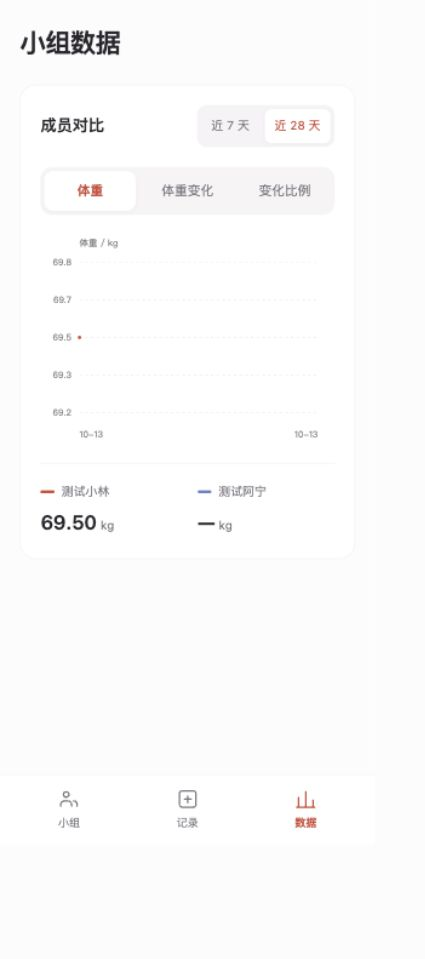

# 上秤 · 本地基础版开发与验证

日期：2026-10-13（北京时间）。执行依据：项目总控 v1.9、PRD v0.12、视觉 v2.0、开发任务清单；本批事实已同步总控 v1.10 与 PRD v0.13。

当前摘要见[开发交接](../开发交接.md)，可复用方法见[开发流程与经验](../开发流程与经验.md)。以下按批次保存历史证据；不同批次的测试结果与预览停留位置不可混用。

## 本批已确认与工程选择

- 用户选择手机号验证码优先。已构建验证码登录契约、稳定账号与服务端会话；本地适配器明确展示未发送短信的测试验证码。真实供应商、签名与模板仍未接入，不称为生产手机号验证。
- 用户确认修改周期后保留身高体重、取消全员准备，每人重新确认新目标。代码和测试已实现。
- 本批工程选择 Node 24.19.0 ESM＋原生模块化 Web＋SQLite；无第三方运行依赖，复用珊瑚色视觉。原因是本机系统 Node／Git 不可直接使用，现有受支持运行时可运行内置数据库；先交付可复现纵向链路。生产 React／TypeScript／PostgreSQL 等方案没有被自动宣布批准。
- 开发字段暂用昵称 20 字、介绍 200 字、准备／日常体重 20–300 kg、身高 80–250 cm。正式范围、低 BMI 行为及身高保存期限未由本批代为定案。身高仅在本人准备编辑接口可读，组内展示接口不返回；开营后编辑入口锁定。
- 数据库为 `var/development.sqlite`，不导入 `qingyou-v1` 演示数据；测试使用独立内存／临时库，浏览器仅使用合成测试账号及数据。

## 完成的代码范围

已建立 Web→版本化 HTTP API→SQLite 的本地真实链路；新增关系表、事务、唯一记录约束、数据库迁移、领域计算、契约常量、健康检查和 CI 基础配置。数据库、会话、成员和记录不再靠前端数组或 localStorage 充当权威。

实现创建与动态邀请、加入、准备、编辑、组队退出与权限交接、开始确认、中途加入、当天记录与覆盖、7／28 天个人／全组分析、到期复盘、本人历史、未更新站内提示、本人导出、账号注销及本地支持请求。邀请码不会在满员时撤销，成员之间共享本期历史，未加入者只见最小邀请详情。

开始／编辑／准备以房间版本校验；记录有当日版本和覆盖确认；写操作带幂等键，未知结果保留原键核实，不自动跨日提交。截止瞬间请求立即只读，30 秒到期任务辅助持久化。提醒由事务领取，两个设备不能先读后各展示一次；跨日、记录更新及到期后，旧请求重试不会复活过时提示。

客户端有焦点限制与返回、底部面板、固定主操作区、错误／网络重试提示、暂停后台轮询、错误退避、登出内存清理和带房间 ID 的路由恢复。无付费墙、AI、聊天、补录或预览场景工具。

## 自动化证据

本次实际执行：

```sh
/Users/liuyuchen/.cache/codex-runtimes/codex-primary-runtime/dependencies/node/bin/node scripts/check.mjs
/Users/liuyuchen/.cache/codex-runtimes/codex-primary-runtime/dependencies/node/bin/node --test tests/*.test.mjs
```

结果：**12 个模块语法检查通过；24 项测试通过，0 失败、0 跳过**。HTTP 集成测试获准临时监听本机随机端口。

| 证据 | 覆盖 |
| --- | --- |
| `tests/domain.test.mjs` | 175 cm／80 kg／中档 14、28、56 天固定目标；四档顺序、BMI 上下界、时间节点及插值；北京时间、单位、缺失日、首条基准、覆盖率和整数并列 |
| `tests/service.test.mjs` | 验证码单次／次数／冷却、声明、幂等、成员隔离、准备锁定、改周期、权限交接、空组关闭、满员恢复、14／13 天中途加入、记录覆盖／跨日、到期／历史、提醒轮次、导出／删除、数据库重开恢复 |
| `tests/http.test.mjs` | UI 资源→账号→组队→准备→开始→记录→第二独立 Cookie 会话读取；CSRF／越权／撤销；8 个并行创建同键返回同一房间；并行开始只生效一次；错误码与注销 Cookie |
| `tests/regressions.test.mjs` | 北京时间跨日使开始预览失效；结束期全期复盘与近 7 天分析各自保持口径；非开发短信适配器不暴露开发验证码 |

Node 实际版本 `v24.19.0`，SQLite 实际版本 `3.53.3`，内置 Git `2.53.0`。系统 Git 报缺少 Xcode 工具，改用已有的 bundled Git；未安装系统开发工具。第一次本机绑定端口遇到 `EPERM`，授权仅本机监听后成功，不是业务接口错误。

CI YAML 已创建，但未提交／推送，也未执行远端 Actions。自动化不证明医学效果、真实短信、实机或生产稳定性。

## 浏览器证据

使用 Codex 内置浏览器实际操作：

1. 创建入口→手机测试验证码→默认未选的年龄／数据声明→创建确认→单人大厅。
2. 提交身高体重→服务端目标／准备成功；单人无法开始，结果不显示身高。
3. 动态邀请链接→退出账号→第二个合成账号登录→回到原邀请→加入同一大厅→完成准备。
4. 创建者重新登录恢复原小组→全员已准备→核对服务端起止日期→正式开始。
5. 保存 70 kg→刷新仍在→切为 140 斤→输入 139 斤→确认前后值→数据库保存 69.50 kg。
6. 全组体重维度显示 69.50 kg；只有一个点时概况显示数据不足；成员姓名进入个人分析，明细底部面板显示同日 69.50 kg；带房间 ID 的分析路由刷新后恢复。

独立会话的数据一致性由 HTTP 测试证明；浏览器为两个账号顺序切换，没有假称两台真实设备。观察到的 CSS 布局宽度为 375、390、429，无横向溢出；375 记录页的「公斤」换行问题已修复。精确 430 px、iOS／Android 实机、键盘与安全区仍列正式 QA。

控制台读取无 error／warn。浏览器验证截图（合成数据）：



## 仍未完成的准入

真实短信渠道与手机归属验证；生产架构、部署区域和 HTTPS；正式字段限制、低 BMI 配套政策、身高及健康数据保留期限；单独撤回共享的完整处置流程；加密可恢复备份与删除重放；线上支持时限／受理渠道；性能负载、监控及 iOS／Android 实机。当前默认仅 loopback，明确阻止生产模式和外网监听，不能公开收集真实健康数据。

没有接入 Vibe Pay，也没有创建收费商品；按总控 P2，待基础准入和收费决策后实施。此次没有代报名、签约、收费或发布。

运行与本地支持命令见 [README](../../README.md)，字段与错误协议见 [API 契约](../engineering/API契约.md)。

## 2026-10-14：两项界面验收反馈

用户确认：已有未结束小组时，首页只留「返回当前小组」一个大按钮，历史小组／账号与支持／隐私等小按钮继续可点。没有当前小组时保留创建／加入；以服务端 currentRoomId 为准，待开始与进行中都适用，已结束历史不占当前小组入口。已修改正式前端并同步总控 v1.11、PRD v0.14、视觉 v2.1 和任务 UI-02／UI-04。

首轮「修改今日记录」沿用了参考图的浅灰／浅紫卡和同色数值，用户后续指出未突出变化。现按最新反馈及静态源码修正为暖灰／浅珊瑚卡、旧数值灰色／新数值珊瑚红、大数字配小号 kg、中央轻量箭头，保留整行确认修改与取消。原[参考图](../evidence/record-edit-reference.png)仅作为构图记录，最新配色见下方；prototype/ 参考源码未改动。

实际浏览器验证：首页只有返回大按钮；历史和账号与支持弹层均可打开，返回按钮进入同一小组。无会话入口保留创建／加入。原有今日值 65.00 kg，临时输入 66 kg 后弹窗正确对照；取消保留输入，刷新仍为 65.00 kg，未提交测试修改。实际 375 CSS px 下两卡同一行、数值无截断、页面无横向溢出。预览已恢复原尺寸。

本批仅修改前端交互与文档，12 个模块语法检查及 Git 差异空白检查通过；未新增重复单元测试，也未重新宣称已运行上一轮 24 项后端测试。

证据：[已有小组首页](../evidence/home-current-room.jpg)、[修改记录弹窗](../evidence/record-edit-confirm.jpg)、[窄屏弹窗](../evidence/record-edit-confirm-mobile.jpg)。

后续配色验收反馈：旧值改为灰色 #8B8589，新值为珊瑚红 #CF4938；两卡使用暖灰／浅珊瑚底，数字加大、kg 缩小，中间以轻量箭头表达修改关系。已同步视觉、PRD 与 UI-04，核对 prototype/app.js、prototype/styles.css 无修改。浏览器预览显示 65.00 → 60.00 kg 的前后对照，未确认提交；实际 375 CSS px 下两卡并排且文字无溢出，已恢复预览尺寸。JavaScript 语法及 Git 空白检查通过。当前配色证据见[最新版确认弹窗](../evidence/record-edit-confirm-coral.jpg)，前述截图保留为首轮验收历史。

单位选择器动效反馈：用户认可现有胶囊圆角，要求平滑过渡，仅参考 Apple 液态玻璃的动效，不采用玻璃外观。已在视觉需求及个人风格偏好中记录。正式前端使用持续挂载的白色滑块，420 ms 位移动画配轻微拉伸和柔和回弹；切换只更新选中状态、数值与单位，取消原来整页重绘，减少动态效果设置下关闭动画。

浏览器已验证 60 kg ↔ 120 斤、目标 78.86 kg ↔ 157.72 斤同步；快速往返切换保留正确选中态和按钮焦点。输入 60.125 kg 往返多次后以 60.13 kg 展示，再切到斤仍为 120.25，未因显示舍入反复累计误差。输入已恢复 60 kg，未提交记录；预览停在斤选项，可直接来回体验。12 个模块语法检查通过，浏览器控制台无 error／warn。截图仅记录[选中后的外观](../evidence/record-unit-slide.jpg)，动效以实际交互查看。


## 2026-10-14：数据筛选与主导航动效统一

按用户对数据页三处批注，将近 7 天／近 28 天、体重／体重变化／变化比例、小组／记录／数据主导航统一为记录页同样的胶囊圆角、浅灰轨道、白色选中块与珊瑚红选中文字。位移动画约 420 ms，带轻微拉伸和柔和回弹；仅参考 Apple 的动效，不使用玻璃外观。手机主导航横向移动，桌面侧栏纵向移动；减少动态效果设置下关闭位移与拉伸。

正式前端保留导航节点，切页只替换内容区；图表筛选保留控件和焦点，单独刷新图表、数值与个人分析统计。范围请求期间可以继续切换，旧响应不得覆盖最新选择；请求失败时恢复已加载范围。已同步个人风格偏好、视觉需求和 UI-01／UI-06／UI-07 任务补充，prototype/ 未改动。

浏览器实际验证：范围 7→28 天往返、三个维度切换、数据→记录→小组→个人分析→数据；体重为 60.00 kg、体重变化 −9.50 kg、变化比例 −13.67%，个人分析仍显示 2 天记录、100% 覆盖率。范围和维度按钮保留焦点与正确选中态，导航在同一小组内保留滑块。原公斤／斤切换正常，未提交任何体重记录。

实际 375 CSS px 下三项维度同排、页面无横向溢出；记录保存区底边约 770.32、导航顶边约 770.77，没有重叠。桌面实际 1136 CSS px 下核对纵向滑块与选中按钮落点一致。已恢复 598 CSS px 的用户预览尺寸并停在数据页。12 个模块语法检查、Git 差异空白检查通过，浏览器控制台无 error／warn。本批没有重跑后端测试；减少动态效果降级为样式实现，系统设置与实机动画未实测。

截图仅展示最终外观，连续动效在预览中点击体验：[数据筛选与主导航](../evidence/data-shared-capsules.jpg)。


## 2026-10-14：用户认可与聊天交接

用户认可最新胶囊筛选及主导航效果，并要求维护开发经验和流程后切换聊天。已建立短交接入口、可复用经验文档和根目录 AGENTS 阅读指引；README、总控、任务清单及视觉／偏好文档补上入口与认可状态。总控的旧静态原型现状表明确标为历史，避免新聊天把已经完成的真实本地功能重新列成未开发。

交接记录区分正式本地应用与原型、已确认规则与未决事项、既往测试与本次文档核验；补充捆绑运行时、持续挂载滑块、请求竞态、单位精度、实际 CSS 视口与截图边界、维护闭环。保留现有源码、数据库、未跟踪文件和服务；本次不改代码、不代用户提交记录、不提交／推送／部署，也没有重跑业务测试。用户最近停留在记录页，旧段落的“预览停在数据页”等仅是各批验收当时状态。

本次文档核验：检查 9 份维护文档的 70 个本地链接，目标均存在；Git 差异空白检查通过。此项只证明文档链接与格式，不增加业务或实机验收结论。

## 2026-10-14：基础稳定性与异常记录恢复

用户认可现有效果后授权继续开发，本批落实先前提出的基础 QA 方向，保持正常界面与胶囊动效。正式应用外网／生产限制未解除；不涉及收费或真实健康数据试用。

### 问题与实现

- 原请求逻辑只捕获 fetch 失败，响应 JSON 截断不进入网络恢复分支；5xx 还会清除请求编号。新增 `apps/web/request.mjs`，连接／响应解析／5xx 结果未知时保留原参数对应的幂等键，确定的业务拒绝后释放。旧会话的迟到响应不能删除新会话的请求编号；页面层也用会话代次阻止迟到结果更改界面。
- 原记录页在结果未知时缺少明确的后续操作。现在保留当次输入、路径、日期与版本，输入暂只读，主按钮显示「核对保存结果」；同组导航往返仍保留状态，由用户显式用原请求重试。确认成功后恢复编辑。该状态仅在页面内存中，不新增身体数据离线存储或自动提交。
- 保存成功后的同步读取原来可能把整个流程报为失败。现在先记录确定的保存结果，后续读取失败明确显示「记录已保存，数据同步暂时中断」。跨日、覆盖冲突继续保留录入值，核对服务端日期／最新旧值后重新提交；取消不写库。
- 会话来源失效引导重新登录并清除私有状态；读取小组被拒绝时清除页面缓存，轮询也经过同一路径。切换历史／其他小组时清理旧组记录草稿，防止串组。
- HTTP 原来只在读取请求内容前检查到期，缓慢上传可跨过截止时间。现在完整读完内容后再次到期检查，再执行身份、权限及业务操作，后台任务是否运行不影响该检查。

### 自动化证据

完整套件 **38 项通过，0 失败、0 跳过**；其中新增 14 项。覆盖最后一个名额竞争及失败者再次加入、同账号并行抢不同组、准备／编辑／退出与开营竞争、不同请求编号的重复开营、同日覆盖竞争与最新值、真实 HTTP 已提交但响应丢失的同键重试、连接／JSON／5xx 的请求编号保留、旧响应与新请求隔离。

缓慢请求测试采用真实分块 HTTP 内容：第一段在北京时间最后记录日 23:59:59 到达并观察房间仍 ACTIVE，然后推进可注入时钟至结束瞬间，发送第二段；结果为 `409 ROOM_LOCKED`，房间转 ENDED，记录数仍为 0。不依赖等待真实午夜或后台定时任务。

本批先重跑原有 24 项作为基线，再在修复与补测后通过 38 项；受限环境首次 HTTP 测试因 `listen EPERM` 失败，按权限流程允许仅本机临时监听后通过。最终 15 个 JavaScript 模块语法检查及 Git 差异空白检查通过。远端 CI 未运行。

### 浏览器证据与复现

`scripts/browser-check.mjs` 使用内存库、固定时钟、两个合成账号及独立无头 Chrome，不读取／写入 `var/development.sqlite`，不接管用户现有浏览器。覆盖冲突使用同一账号的两个独立 Cookie 会话，在两个真实页面分别提交。

实际通过 7 组流程：

1. 服务端已提交，浏览器收到不完整 JSON → 输入与待核对状态保留 → 数据／记录导航往返 → 显式核对 → 数据库仍只有一条、版本仍为 1。
2. 浏览器断网时确认覆盖 → 数据库不变 → 恢复网络并核对 → 原已确认输入保存，版本只增加一次。
3. 第一会话打开确认，第二会话保存不同值 → 第一会话被拒绝并保留输入 → 再次确认显示最新旧值 → 取消不写库。
4. 北京时间跨日后确认旧表单 → 不写次日 → 保留输入、切换权威日期 → 再次显式保存才产生次日记录。
5. 写入成功后阻断 `/me` 同步 → 明确显示记录已保存，输入可继续编辑，数据库值正确。
6. 实测 375／390／430／1136 CSS px 无横向溢出；390 下保存区底部 770、导航顶部 770，无重叠。浏览器模拟减少动态效果，单位换算正确且不保存。切换视口后的首张截图有合成帧异常，DOM 只有一个标题；刷新后重新截图，未据此改动产品布局。
7. 服务端撤销账号会话 → 轮询引导登录，记录表单与导航移除。两个浏览器页面无未捕获 JavaScript 异常。故障注入期间预期会出现网络失败，不将其误报为无网络错误。

运行命令见 README「检查」；Playwright 为本机已有的可选 QA 依赖，不加入正式运行依赖或默认 CI。截图：[稳定性批次记录页](../evidence/stability-record.png)。截图为合成数据的正常最终状态，异常逻辑以脚本步骤和数据库断言为证。

本批开始时端口 4180 无监听，已恢复仅本机预览，健康检查返回 `ok:true, storage:true, mode:development`；没有替换或重置开发数据库，也没有代用户提交体重。保留全部原有未跟踪成果，未提交、推送或部署。

### 下一步与边界

QA-01 仍为进行中：本批不宣称穷尽所有事务顺序或故障。后续可继续准备／编辑表单异常恢复及隐私撤权生命周期；独立撤回共享、保留／备份删除规则、低 BMI 配套、真实短信和生产架构仍需相应决策。UI-09 只增加浏览器尺寸与模拟减少动态效果证据；真实 iOS／Android、键盘、安全区、系统偏好及真实多人持续使用仍未验证。

## 2026-10-14：云端合成数据联机测试版

用户明确要求先迈出一大步，授权做可分享给朋友的联机测试版，并提供云服务器 `101.132.150.197`、说明 SSH 密钥已配。通过 root 密钥连接后只读确认 Ubuntu 24.04.2、x86_64、无现有应用或 80／443 服务占用，再部署独立目录、用户、数据库和进程。本地开发数据库未上传、重置或用于验收；本地 4180 已重启加载新接口，确认仍为 local／phone 模式。

交付地址：[在线测试版](https://101.132.150.197)。正式源代码增加 local／test 运行边界、HTTPS 精确 origin、Secure Cookie、专属体验码登录和合成数据标记；测试模式关闭手机号验证码接口。体验码是 144 位随机登录凭据，仅把 SHA-256 摘要上传服务器；同一码恢复同一身份。原正式手机号优先决定不变，真实数据生产模式未启用。

服务器使用 `/opt/payathon-test/releases/20261014T060555Z` 与 current 链接，隔离 Node 24.19.0（官方 SHA-256 校验通过）、Certbot 5.8.0、Nginx 反代、`payathon-test.service` 非 root 应用用户。数据库在 `/var/lib/payathon-test/test.sqlite`，Node 仅监听 `127.0.0.1:4181`。必要 Ubuntu 包及依赖更新发生在首次准备过程中；Certbot 最终使用 HTTPS 源在独立虚拟环境安装。部署文件与维护命令统一见[联机测试部署](../operations/联机测试部署.md)，不在多处复制。

**本批验证：**服务器 41 项测试通过，0 失败、0 跳过，19 个模块语法检查通过。本机既有 7 组异常浏览器流程复验通过。公网 Chrome 使用两个独立 Cookie 会话与合成测试账号完成：体验码登录 → 首次声明 → 创建 → HTTPS 邀请 → 第二账号登录并加入 → 双方准备 → 开营 → 双方分别保存 70／60 kg → 共享图表与第二会话 API 一致 → 退出重登恢复同一身份／小组／记录，无未捕获页面异常。截图：[公网共享数据页](../evidence/online-shared-data.png)。账号 5–8 用于 QA，1–4 保持未使用，交给用户自行体验。

公网验收发现开营后异步提醒尚在处理时，新渲染的导航按钮看似可用但点击被全局 busy 忽略。已修复为新页面／弹窗按钮同步忙碌状态，最终恢复当前 DOM 中的按钮，不把原本因业务条件禁用的按钮误启用；既有短信冷却与图表筛选行为保留。首次打包遗漏 macOS 元数据，服务器语法检查在激活前拦住 AppleDouble 文件；去除元数据重打包后通过，发布脚本也排除该类文件。验收脚本同步修正手机返回首页路径、已有活动小组准备字段和退出完成后的重新登录时序，最终完整流程退出码 0。

测试服务实际重启后，四张业务表的用户 4／小组 2／成员 4／记录 2 及 SHA-256 摘要均保持相同：`a79433031a1d0c5bc999e1e54b05249a20921de8b53376871b07779a0295b732`。公网健康仍为 `ok:true,storage:true,mode:test`。应用与证书定时器均 enabled，应用 active；不将重启保持数据等同于备份恢复演练。

已实际签发可信 IP TLS 证书，SAN 为 `101.132.150.197`，有效至北京时间 2026-10-21 05:08:14。`payathon-cert-renew.timer` 每 6 小时检查本项目证书。首次 staging dry-run 遇到 `rateLimited / Service busy`、Retry-After 28 秒；超过等待后仅再试一次，所有模拟续期成功，Nginx 检查／重载 hook 通过，未替换当前有效证书。依据为[Let's Encrypt 官方 IP Certbot 指南](https://letsencrypt.org/2026/03/11/shorter-certs-certbot)。

本批是已部署的合成数据测试环境与公网浏览器验证，不是两台真实手机实测、真实短信、真实健康数据开放、支付或正式生产准入。下一步优先用户与朋友的手机体验，按实际阻碍推进，不自动恢复细微异常清单。未代用户提交、推送或发送邀请消息；私有体验码与 SSH 指纹留在已忽略的 `var/test/`。

## 2026-10-14：手机体验说明与再次聊天交接

用户明确要求用手机体验，已给出公网网址、专属体验码、登录创建及两人邀请流程，并说明可通过微信文件传输助手把入口送到手机。账号 1 对应用户、账号 2 对应朋友，明文只保留在私有体验账号文件，不复制进受跟踪文档。用户最后反馈「真不错」，要求维护本聊天相关文档后切换窗口；尚未提供机型、浏览器或具体完成步骤，因此记录为交付认可，不新增完整手机实机验收结论，也不再假定人工体验账号仍未使用。

本次同步开发交接、联机测试说明、README、总控的阶段与下一步，并将打包元数据、远端工作目录、动态按钮 busy、公网脚本时序和证书限流重试归入开发流程经验。修正交接旧的“仅本地”描述、已完成的续期演练状态及继续细微 QA 的旧顺序；下一轮先接实际手机反馈，沿用现有站点、账号和数据库。

维护开始时 Git 工作区干净，代码、部署配置与文档已跟踪。本次仅维护文档，不修改代码、私有体验码、数据库或服务器，不执行提交／推送／部署，也不重跑此前 41 项测试、续期演练或浏览器验收。核验 6 份文档的 56 个本地链接，目标均存在；Git 空白检查通过。此项只验证文档链接与格式，不增加业务验证结论。

## 2026-10-14：备份恢复与运行保障

用户反馈「目前看来效果还可以」，要求读文档说明下一步，随后回复「做吧」，授权本批运行保障及手机实际反馈修复。开始时保留已有 6 份交接文档修改；没有具体机型、浏览器或新的手机问题，因此本批没有改正式应用界面、业务逻辑或静态原型。线上只读检查确认应用、Nginx 与证书定时器 active，原库使用 WAL、约 116 KiB 主文件与日志，尚无可恢复备份。

### 实现与实际安装

新增 `scripts/lib/backup.mjs`、备份 CLI、运行检查模块／CLI、无干扰故障演练脚本、7 项运维测试以及 `deploy/` 的独立安装脚本和两个 systemd 定时器。完整行为、阈值与处置命令统一见[维护手册](../operations/备份恢复与运行检查.md)，不在此复制日常操作手册。

备份使用 Node SQLite backup API，在源库保持在线时生成快照；仅将新快照切为 DELETE 日志模式，消除跨机器对 WAL／SHM 的依赖。快照全表摘要、结构版本、完整性和外键校验通过后，使用包内对应源码在新私有目录、仅本机随机端口启动应用。逐账号读取本人、历史、支持请求与在组小组／记录；临时会话只写恢复副本。包另含账号摘要及环境配置，文件 SHA-256 与恢复报告齐全后才原子发布；异常不发布成功目录，最新完成包损坏不回落旧包掩盖问题。

最终运维发布目录 `/opt/payathon-ops/releases/20261014T111512Z`，current 指向该目录。它与既有应用发布目录独立；没有使用覆盖 app.env 的首次应用部署脚本，也没有重启应用。备份任务以 `payathon-test` 执行，源库／配置只读、仅备份根目录可写；监测需要读 systemd／journal，配置文件和状态不经公网开放。每小时备份及每 5 分钟检查已 enabled；最终检查中监测 timer 在北京时间 **19:20:24** 自动触发，**19:20:25** 写入正常状态 `ok:true,issues:[]`；下一次小时备份显示 **20:00:43**，不把未来触发写成已发生。

### 验证证据

- 本机全量测试在初版通过 48 项；最终快照单文件化和包内源码恢复改动后相关 7 项运维测试再次通过。本机最终 25 个模块语法检查、Bash 语法与 Git 空白检查通过。服务器最终候选发布目录全部 **48 项测试通过、0 失败／跳过**，25 个模块语法检查及四份 systemd unit 验证通过。
- 运维测试覆盖：打开着的 WAL 库备份、所有业务表一致、双身份 HTTP 读取、源库不变、后续在线记录不改变旧备份、私有权限及配置／对应源码保留、损坏／缺失备份与未发布目录清理、结构版本／外键异常拦截、健康响应异常／跳转／断连、备份任务失败／过期／证书／磁盘／日志故障判断、状态失败与恢复。测试均使用隔离数据，没有操作用户现有数据库。
- 最新备份 `2026-10-14T11-15-19-358Z-654cde86-d1d4-456d-8a02-f1e21fc6e5e0`：服务器恢复读取 **6 个账号、6 次成员小组读取，244 ms**。这只是临时副本恢复及 API 读取耗时，不是停机恢复 RTO。
- 在线执行 `scripts/operations-drill.mjs`，空的临时备份目录实际触发 `BACKUP_INVALID` 与 `BACKUP_STALE`；恢复指向真实备份后检查正常、状态转移通过。实际服务、备份和正式监测状态未被故障注入改动。其他阈值故障来自自动化测试，没有停掉在线应用来制造宕机。
- 服务器外副本传输首次被自动审批拒绝，理由是含配置的备份复制尚未明确到具体目的地；未绕过。用户随后明确回复「允许保存到这个本机目录」，才重试并保存到私有 `var/test/backups/`，Git 忽略已核对。在本机从该包内 Linux 源码与数据库独立恢复成功：**6 个账号、6 次成员小组读取，58 ms**，演练服务只监听本机，临时文件已清理。这是一份当时快照，不是持续异地同步。
- 安装前、安装后及最终只读复查：用户 **6**／小组 **3**／成员 **6**／记录 **4**，四表摘要均为 `9d59443e6f826082ad56727630f000c52040ce79fa9b3ff8ef0ac08f0da1a46c`。应用 PID **59537**，启动时间仍为北京时间 **14:21:24**；当前应用发布没有切换。最终公网健康 `ok:true,storage:true,mode:test`。监测样本本机 **57 ms**、公网 **79 ms**，证书剩余约 **153.8 小时**、最近 6 分钟应用异常 **0**、可用磁盘约 **36.8 GB**；这是一次采样，不是长期性能／容量结论。

### 边界与下一步

本批交付的是合成数据测试站运行保障。没有实际替换在线库、执行新服务器接管、版本回滚、完整故障停机测量或真实手机验收。状态和日志在服务器本机；外部通知、独立外部探针及自动异地备份未配置。暂不自动清理备份，真实数据保留／删除重放需与隐私规则一起冻结；不得恢复旧备份后使已删除信息重新共享。

下一步接具体手机反馈，并准备正式短信、低 BMI 目标行为、数据保留与撤回共享的具体方案。保持现有网址、账号和在线库；真实数据、收费与参赛提交仍未开放。本批已安装运维工具并更新 README／总控／交接／任务／部署／经验与新维护手册，未提交或推送。私有配置、体验码与备份没有加入 Git。

## 2026-10-14：用户确认保留当前算法，不增加低 BMI 限制

用户明确决定「不用限制。用户是成年人，有自由支配自己身体的权利。保留当前的算法即可」。据此确认：通过既有输入技术校验的成年用户继续按当前公式生成目标，起始或目标 BMI 低于 18.5 时也不增加拦截、目标截断或自动仅记录模式。研究稿中原有的候选自动建议限制被此决定取代，前述历史记录中的“低 BMI 待定”不再代表当前状态。

核对 `packages/domain/index.mjs`，现有实现已符合决定，保留公式、版本与已锁定目标。仅同步总控、PRD、算法研究、API 契约、任务清单、README 和交接；不改应用代码、界面、原型、数据库或服务器。既有 5 项领域测试通过，包含低 BMI 输入仍按原公式计算的样例；未新增测试、提交／推送／部署或实机验证。下一步仅继续正式短信、输入正式规格、数据保留与撤回共享等剩余事项，不再重复提出低 BMI 政策待定。

## 2026-10-14：三项开发准备评估与文档维护

用户要求评估正式手机号登录、目标边界和数据控制现在是否可以开始，并在可行时维护文档继续。核对开发交接、总控、PRD、任务及 API 契约，检查服务层、运行配置、HTTP、账号／隐私界面、表结构、备份恢复工具和已有测试。结论：具备分批开发基础，不能直接宣称真实试用准入完成。

源码证据：手机号 OTP／会话及 `deliverCode` 注入点已有，真实供应商适配未接；运行入口只允许 local／test，分别限制非开发短信和手机号登录。验证码当前先落库再投递，需补齐发送状态、配置缺失／投递异常与并发协调。目标算法已符合用户决定，无须新功能。本人导出／注销级联在线删除已有，独立撤回没有接口／状态，注销对成员交接只显式处理待开始持有人；保留期限、按范围删除和恢复旧备份时的删除重放未实现。当前备份仅接受结构版本 1，下一阶段数据迁移需同步恢复工具。

新增[真实试用推进方案](../plans/真实试用推进方案.md)，给出可先开始的工程、短信外部依赖、集中待确认的数据规则及验收顺序；同步 README、总控、PRD、API 契约、任务和交接入口。未自行指定供应商、采购、保存天数或撤回后的成员行为，未将建议当成已批准要求；低 BMI 不再列为待定。现有测试站、账号、记录及私有备份继续保留。

本次只做源码核对与文档维护；未运行应用、发送短信、修改代码／表结构、实施清理、部署、提交或推送，不重跑业务测试或新增实机／线上验收。文档链接与 Git 格式检查见本轮工具结果。下一批先推进手机号投递适配／发送状态和数据控制技术契约，再落实供应商条件及确认规则后实施真实联调和相关隐私行为。

## 2026-10-14：文档去重与入口精简

用户要求检查并精简冗余。将交接改为短入口，任务清单只保留最新状态、依赖与验收映射；逐批实现／测试流水账继续集中在本文，已有历史证据原文保留。总控、PRD、任务和视觉文档中的重复规则／公式／验收及原型缺口表改为职责文件引用，移除已由 API 契约取代的候选路由表；保留各章节编号、任务／决策／验收 ID、已确认规则、算法研究和独立运维手册。按已有决定校正 PRD 的高强度确认、改周期、已实现能力与统计锚点等过时描述，未增加业务要求；清理算法研究指向不存在 v0.1 历史稿的链接。文档分工见总控 2.1，可复用维护规则写入开发经验。

首轮审计中 7 份核心文档由 86,924 字符缩至约 68,400 字符（约 21%），交接从 79 行缩至 35 行；最终数字及链接／编号完整性以本轮工具检查为准。本批仅维护文档，未修改应用、原型、数据库或服务器，未提交／推送或重跑功能／实机／线上测试；保留原有未提交与未跟踪成果。

## 2026-10-14：短信工程准备与注销恢复保护

用户授权推进正式登录和数据控制，目标算法保持不变。随后用户要求先讨论“撤回小组数据共享”的含义，并询问历史能否一直持久保存。本轮明确区分收回组内读取授权、删除数据、注销账号；技术上可长期保存，建议历史保留至本人主动删除／注销，但尚未形成具体保存政策。撤回后的参与／名额／再次加入仍待讨论；未新增该产品行为或自动清理任务。

实现内容：

- 新增 `apps/api/sms.mjs`：投递契约必须显式返回 ACCEPTED；默认 8 秒超时、AbortSignal、不自动重发、明确失败和未知结果分别处理。可选阿里云 SendSms 适配使用固定 HTTPS 地址、ACS3 签名、关闭跳转、验证配置并屏蔽原始报文；只按官方接口实现，未真实验签／发送，未决定供应商或采购。
- 验证码持久状态 PENDING／ACCEPTED／FAILED／UNKNOWN／DEVELOPMENT；待发送及失败不能验证，dispatch_id 防止迟到结果覆盖新码。缺适配器不留码，失败保留冷却，过期清理及遗留待发送转未知。前端清除旧开发码提示，供应商受理显示“已受理”，不声称手机送达。运行入口仍拒绝真实生产模式；local／test 不自动启用适配器。
- 新增结构 2 迁移和条件迁移运行器，避免每次打开重设版本。升级保留账号和记录、作废旧验证码；新增 privacy_meta 绑定独立清单。
- 新增独立 SQLite 删除清单，默认业务库旁 `.deletions.sqlite`，权限 0600、同步 FULL；只含账号随机 ID、事件 ID、时间和序号，无手机号和身体数值。注销先提交清单，再事务清理在线表及相关缓存提醒结果；启动在提供接口前补处理未完成事件。缺清单、空文件、身份不符、已知序号落后拒绝启动，持久库拒绝内存清单。
- 恢复工具支持结构 1／2，核对原快照后在隔离副本用最新独立清单重放，再启动业务读取；清单只读，在线源库和原备份不改写。新版快照不附带可回滚的清单副本，恢复需显式提供当前清单。旧版本 1 合成备份兼容保留，但不能补回当时未记录的删除；有当前清单时必须传入。清单异地保存、加密／密钥和备份淘汰仍未落实。

验证证据（本地隔离合成数据）：

- 完整 56 项自动化测试通过、29 个 JavaScript 模块语法检查通过；首次受限环境 HTTP 测试因 loopback `listen EPERM` 未执行，获工具自动审查允许后重跑通过。旧“投递器无返回即成功”的回归替身改为新显式 ACCEPTED 契约，未放宽断言。
- 新增短信测试覆盖待发送不能登录、并发／重发限流、明确拒绝／空结果／异常、超时取消与迟到结果、过期及旧库升级、同手机号恢复稳定身份、配置与响应脱敏。阿里云请求仅使用替身校验固定 endpoint／字段／签名头形状，不等于供应商实际验签。
- 新增删除测试：删除前快照包含两名用户，注销后带最新清单恢复只剩一名；被注销会话无效，本人关联表数据消失，幸存成员可读；源库及原快照不变。模拟清单已提交但在线事务未执行，启动补处理成功；缺失、空、错误清单和内存清单均拒绝。
- 独立 Chrome 无头浏览器、390×844 CSS px、内存库及替身短信：获取码显示受理提示、无开发码面板、重发倒计时、正确码进入资料确认；服务端注销后轮询回到登录，零未捕获页面异常。未发送真实短信，未访问用户浏览器或真实账号。

同步 API 契约、真实试用方案、交接、任务状态、总控 D02／D09、README、运维手册及无凭据配置示例。保留已有未提交／未跟踪成果；未修改原型、用户账号／数据库、现有私有备份或服务器，未重启既有服务、部署、提交或推送。后续先继续数据规则讨论并落实短信外部条件；正式配置准入、真实收发、独立撤回／按期删除、备份物理淘汰、清单异地持久化和实机仍未完成。

## 2026-10-14：移除独立撤回共享范围，完成短信离线接入准备

用户明确表示没必要设计“撤回共享”功能，要求继续；补充确认目前没有短信账户，先完成接入准备。将独立撤回的入口、状态、成员／名额／重新授权规则从当前范围与验收中移除，同步总控、PRD、API、任务、交接、试用方案和运维手册；保留已有导出、注销删除和支持入口及通用会话／退款撤权检查。没有将询问“历史能否一直保存”自动解释成已确认的无限期政策，仍不开自动清理；按期删除尚未获确认，不默认增加。

新增离线 `scripts/sms-check.mjs`／`npm run sms:check` 和无凭据 `deploy/sms.env.example`。工具只报告配置缺项或格式问题，不联网、不启动服务、不打开数据库、不发送短信或输出配置值；退出码 0 仅表示格式齐全，结果仍带 `CONFIGURATION_ONLY` 和 `deliveryVerified:false`。预检与阿里云适配器共用配置校验，补齐空白字符／模板编号／临时凭据的检查。签名计算提取后，与阿里云官方 V3 文档固定参数示例的预期签名完全一致；未做真实供应商验签，不代表账户、签名审批或送达可用。

核对中发现支持 CLI 未传入自定义 `DELETION_JOURNAL_PATH`，也未补处理清单中已提交但未完成的注销。现已使用指定独立清单，并在读取工单前执行注销补处理；隔离测试证明不会读回已注销者的旧工单。

本地完整 60 项测试、30 个 JavaScript 模块语法检查通过；新增 4 项测试覆盖官方签名向量、预检缺项／脱敏／退出码以及支持 CLI 的清单补处理。配置示例以空凭据离线检查应报告四个必填缺项，属预期结果。文档／Git 格式检查见本轮工具结果；未重跑浏览器或实机，未注册账户、采购、配置真实凭据、发送短信、开放正式模式、修改用户数据、部署、提交或推送。

下一步：账户、主体及已审核签名模板就绪后安排独立真实联调；历史／身高保存、备份与独立清单持久化／淘汰、按期删除是否纳入及正式运行准入仍需落实。旧记录按时间保留，后续以本条及交接的最新决定为准。

## 2026-10-14：个人开发者短信接入条件核验

用户确认纯个人开发。核验阿里云个人开发者短信验证码指南、新手指引、产品计费及短信认证操作文档后，建议优先评估号码认证产品下的短信认证：支持个人实名认证和 Web／H5，使用平台预置签名和模板，无需企业营业执照或自行申请签名模板。当前按量计费月不超过 1000 次为 0.06 元／次，核验免费；快速测试需绑定手机号且发送也会计费。官方来源及用户操作顺序已写入真实试用推进方案。

此建议尚非用户批准采购或供应商选型。已有普通短信 `Dysmsapi/SendSms` 适配器及模板校验不能直接接入短信认证 `Dypnsapi` 资源，若采用须另做发送／核验适配；本轮没有修改代码、开通账户、创建密钥、充值、发短信或部署，未重跑业务测试。同步交接及方案，后续不再把取得企业资质当作当前用户的必经步骤。

## 2026-10-14：中文品牌统一为「上秤」

用户明确要求将产品中文名改为「上秤」，修改所有相关文档与页面。正式应用的首页、导航品牌、HTML 标题、连接占位、本人数据导出文件名及启动提示已同步；静态参考首页、导航、浏览器标题、移动预览工具和邀请复制文案也按本次授权同步。保持原布局、业务流程和样式，英文名尚未确定，不自动采用此前建议。

PRD 重命名为 `fat-docs/上秤产品需求文档.md`，视觉规范重命名为 `fat-docs/上秤前端与视觉需求.md`；更新所有项目内引用及文档中的产品名称，npm 包与锁文件的内部名称同步为 `shangcheng`。服务／目录标识 `payathon`、会话 cookie、原型 `qingyou-v1` 存储键保持兼容；未修改私有账号、应用数据库、备份或既有历史截图。旧截图保留当时验收事实，本次另保存新名称证据。

本轮验证：30 个 JavaScript 模块语法检查通过；本地 Markdown 文件引用检查通过，包名／锁文件一致；扫描项目文本和文件名未发现旧中文品牌残留（排除 Git 历史、私有数据和历史图片）。隔离 Chrome＋临时端口＋内存库验证正式手机首页、浏览器标题、桌面品牌、`上秤-本人数据.json` 下载名；独立原型浏览器验证首页、导航、复制邀请、移动预览标题及 iframe，未捕获页面异常。首轮原型验收误用了不支持的 `preview=group` 参数导致等待超时，改用已有 `previewScreen('group')` 后通过，未因此更改原型行为；桌面截图使用初始桌面视口重新获取稳定合成帧。

新证据：[手机首页](../evidence/shangcheng-home-mobile.png)、[桌面创建页](../evidence/shangcheng-create-desktop.png)、[参考原型首页](../evidence/shangcheng-prototype-home.png)。截图已人工查看；未重跑完整业务测试或实机验收。本机 4180 无既有监听，品牌验收只启动隔离临时服务，不启动或迁移用户持久库；未部署公网、提交或推送。

同时将交接中的短信状态按用户本轮提供的控制台证据校正：个人短信认证已开通，赠送签名可用、登录／注册模板 `100001`，RAM 用户正在创建，密钥保存和真实发送尚未确认。后续继续短信认证专用接口适配及权限／私有配置联调，不将截图当成产品登录已经接通。

## 2026-10-14：短信认证权限与私有配置准备

用户报告已取得登录名称、密码和 AccessKey，询问下一步。核验官方号码认证 RAM 授权定义及用户授权说明，准备 `deploy/ram-shangcheng-sms.json`：只允许 `dypns:SendSmsVerifyCode`／`dypns:CheckSmsVerifyCode`，服务级资源 `*`，建议自定义策略名 `ShangchengSmsLogin`，由用户授权给 `shangcheng-sms`。尚未替用户执行云端授权，不将拥有 AccessKey 当成权限已生效。

新增短信认证专用 `deploy/sms-auth.env.example`（区别于普通短信示例），并以独占新建方式创建 Git 忽略的 `var/private/sms-auth.env`、权限 0600，已填非敏感签名「恒创联众」和模板 `100001`，AccessKey 字段留空，现有文件不会覆盖。不索取或输出真实密钥，控制台登录密码不用于程序配置。准备好后用户只需将 ID／Secret 填入本机私有文件，后续还需实现 PNVS 专用发送／核验适配。

JSON 结构及仅两项动作核对、私有文件权限、Git 忽略和 Git 格式检查通过；没有读取真实凭据、打开应用数据库、创建云端策略、绑定权限、调用付费 API、部署或运行业务测试。真实短信认证、登录和供应商验签仍未完成。

## 2026-10-15：短信配置完成反馈与换窗口交接

用户在创建验证码发送／核验权限策略后回复「OK啦」，随后确认「配置已保存」，并询问短信费用由谁承担。按用户反馈更新为已完成权限配置、已保存本机私有配置；不将其写成已验证 AccessKey、授权生效或真实收发通过。本会话此前查阅官方计费与 RAM 说明：服务费用由开通服务的主账号承担，RAM 调用身份不独立计费；短信认证以运营商送达回执计费、核验免费。价格与来源集中留在真实试用推进方案，实际联调前再核对。

用户要求文档交接以更换窗口。本次重新核对入口、推进方案、无凭据示例及源码检索结果：PNVS 适配尚未实现，旧检查器仅支持普通短信；没有因此前讨论自动完成代码接入。更新交接和推进方案，记录非敏感配置位置、用户完成状态、专用接口的下一步与隔离验证要求，清除仍要求重复开通／待填凭据的过时表述。产品仍用「上秤」、英文名未定、不做独立撤回共享、保持当前目标算法；保存政策未确认，自动清理关闭。

本批仅更新上述三份文档，检查本地 Markdown 引用及 Git 空白格式；未运行或重跑业务测试。没有读取私有配置内容、发送短信、修改代码／应用库／私有备份／服务器、部署、提交或推送；原有大量未提交与未跟踪成果保留。真实发送尚未确定手机号和条数，新窗口先完成 PNVS 专用发送／核验、离线预检及隔离测试，再明确真实联调范围。

## 2026-10-15：PNVS 短信认证适配与已保存配置离线检查

用户要求查阅相关文档、确认已保存短信配置并继续开发。按交接读取正式源码与推进方案，核对官方 [SendSmsVerifyCode](https://help.aliyun.com/zh/pnvs/developer-reference/api-dypnsapi-2017-05-25-sendsmsverifycode)／[CheckSmsVerifyCode](https://help.aliyun.com/zh/pnvs/developer-reference/api-dypnsapi-2017-05-25-checksmsverifycode)：自定义码不能交给平台核验，使用平台生成／平台核验的完整路径。

新增 `createAliyunPnvs`，通过固定 HTTPS endpoint 与既有 ACS3 签名调用认证接口。请求六位数字、五分钟有效、60 秒间隔、覆盖旧码、不取回真实码并关闭自动替换签名重试；发送只表示受理。Check 仅成功调用、流水号匹配及 VerifyResult PASS 时认可，UNKNOWN 视为无效码。供应商原始错误、验证码及凭据不进入应用响应／日志；没有运行真实接口。

服务层根据投递函数的 `verifyCode` 能力选择平台流程，在现有 code_hash 列保存 `pnvs:<dispatch_id>` 标记，不保存真实码／哈希，结构版本维持 2。HTTP 等待远程核验，同手机号核验期间拒绝并发核验及重发，最多五次无效尝试；超时／异常使本次码 UNKNOWN 并要求重新获取。最终事务仅消费当前有效 dispatch_id，随后建立账号和会话；过期、已删除、旧流水号及迟到 PASS 不能签发会话。补充切换适配器时拒绝旧开发／普通短信码，平台码缺失适配器时不回退本地校验。核验锁当前限单个服务实例，仍沿用单进程边界。

新增 `tests/pnvs.test.mjs` 共 12 项，包含模板格式／CLI 脱敏、PNVS 固定请求参数、严格响应与错误脱敏、单次消费及身份恢复、五次上限、并发核验与重发、超时取消／迟到成功、异常无会话、过期／替换／删除、服务重建缺适配器、切换适配器拒绝旧码、HTTP → PNVS 替身 → 会话 → me 及测试环境拒绝手机登录。现有 60 项回归一起运行，共 **72 项全部通过**；31 模块语法检查通过。首次沙箱内 HTTP 测试因本机监听 EPERM 受限，获执行环境扩展后运行；新测试最初用 fetch 改写 Host 被忽略，改用与既有测试一致的 http.request 后通过，无需放宽服务主机限制。

实际读取私有配置仅用于 `node --env-file=var/private/sms-auth.env scripts/sms-check.mjs` 离线检查，报告 ok:true、issues:[]、networkUsed:false、smsSent:false、deliveryVerified:false；另核对文件权限 0600、Git 忽略，不打印值、不改配置。离线通过不能证明 AccessKey／RAM 授权／余额／供应商验签有效，也不能证明手机送达。

同步 README、配置示例、API 契约、任务状态、总控 D02、推进方案及短交接。系统 Git 缺 Xcode 工具，使用开发经验中的捆绑 fallback Git 检查现有工作区并保留所有既有未提交／未跟踪成果。仅测试临时库和随机 HTTP 端口；没有打开或迁移现有应用库、改动私有配置／备份／原型／服务器、重启既有服务、部署、提交或推送。真实发送仍缺测试手机号与条数，下一步在指定范围后准备独立联调入口并验证实际收发；本轮未开放真实健康数据。

## 2026-10-15：服务器版本与账号只读复核

用户询问本次更新是否同步服务器、线上是否已有账号。使用已有主机指纹与 SSH 身份，只读核对当前发布链接、服务状态、源码是否有 PNVS 适配、账号配置数量、SQLite 只读统计及本机配置接口。不读取或输出体验码／密钥／完整手机号／身体记录。

服务器服务 active，发布目录为 `/opt/payathon-test/releases/20261014T060555Z`，PNVS 适配不存在，SQLite 结构仍为 1，证实本轮更新尚未部署。配置已签发 8 个体验身份，业务库已有 6 个测试账号、0 个手机号账号；首次体验码登录才创建业务账号，因此两者数量口径不同。配置接口返回 `mode:test`、`login:test-code`、`syntheticOnly:true`。此为本次只读查询时点，不承诺账号数量永久不变。

本轮仅同步上述事实到短交接与本记录；未部署、重启服务、发短信、写服务器数据库或修改线上账号。下一步仍为独立真实短信联调，测试站沿用体验码。

## 2026-10-15：部署手机短信试用并清空旧在线账号

用户报告已同步 GitHub，并明确要求同步服务器、清空旧账号记录，之后本人手机测试。核对本机基线提交 `08ebc8f3249bc738972642aabdb3760e37afb8d6`、既有服务器及配置；当前发布仍为 20261014T060555Z。原源码虽有 PNVS 适配，运行配置只允许 local／test，直接复制不能启用手机收码。因此在已同步提交上补齐部署所需的独立 sms-trial 配置与验证，未放宽既有模式或开放 production。

新模式仅回环供精确 HTTPS 反代，要求独立持久库、PNVS 远程核验与明确日上限（可设 1–20，本次 10）。全站发送请求在 SQLite 中按北京日期计数，失败／未知也计入，重启不重置。Cookie 带 Secure，旧体验码接口关闭；手机号用真实短信，昵称／身体数据仍使用示例值，登录页／环境提示／数据说明同步。普通本地开发码、旧 test 模式及正式生产门槛保留。助手没有调用真实短信 API。

增加保护性的旧测试清空脚本：只允许 CLI 指向旧 test.sqlite，拒绝含手机号账号的库，先用独立清单逐账号注销，再清理小组、验证码及限流；清空后全部业务表核对 0。首次切换脚本拒绝覆写已存在的新手机库，发布前先完成全部测试、离线配置、运行配置、systemd 和 Nginx 校验。为支持新部署同步备份与监控：trial 快照不复制 app.env／accounts.json 或短信密钥；恢复在隔离本地模式核对数据，不调用供应商；健康探测按实际 APP_MODE 验证。未来备份加密／异地清单／保留政策仍待完成。

本机与 Ubuntu 服务器均通过 **78 项自动化测试、34 个模块语法检查**。新增六项测试覆盖模式准入、HTTPS／Cookie／身份重启持久化、日上限跨日及重启、清空旧数据与拒清手机号库、备份排除密钥／旧身份配置。`scripts/sms-trial-browser-check.mjs` 用隔离 Chrome 390×844 和真实试用模式，验证页面 → API → PNVS 替身 → SQLite → 错码拒绝／正确核验 → Secure Cookie → 资料确认／首页；一次替身发送、两次核验，真实发送为 0。无用户数据或持久开发库参与。

发布包仅含 apps／packages／db／scripts／tests／deploy／package 与 Node 版本文件，74 项、无 var／.env／.git；SHA-256 `9fe75b0115d0869c40157c39376442eec883d80d7c8e4346b6519a65df691269`，上传后再次核对一致。短信配置通过 SSH 单独加密传到服务器 `/etc/payathon-test/sms-auth.env`，root 0600，systemd 读入；不进入包、快照或日志。服务器离线检查通过，不证明 RAM／验签有效。

2026-10-15 11:22 北京时间切换至 `/opt/payathon-test/releases/20261015T032231Z-sms-trial`，应用与运维 current 均指向该目录。按授权删除旧 6 个测试账号及关联在线表，生成 6 条删除事件，并移除旧 accounts.json（8 个体验身份）。新库 `/var/lib/payathon-test/phone-trial.sqlite` 与旧 test.sqlite 分离；发布后两库 users／sessions／rooms／members／records／idempotency／reminder_receipts／support_requests／otp／rate_limits 均为 0。旧私有备份与本机资料保留，不自动恢复；本机开发数据未动。启动健康探测首个样本早于应用监听而失败，内置重试后正常；服务、Nginx 和两个运维定时器 active，新快照隔离恢复通过，监控 ok:true、issues:[]。

公网 Chrome 390×844 只读验证 https://101.132.150.197/#login：模式 sms-trial、手机号输入、one-time-code 属性、计费／示例提示、无开发码和页面异常，验证码发送请求为 0。[手机登录截图](../evidence/shangcheng-phone-trial-login.png)已查看。原在应用浏览器打开工具超时，改用独立 Chrome 验证；没有因此修改服务访问限制。实际手机、真实短信送达／验签／核验／重登仍由用户亲自测试，不把部署／替身通过记为真实收发通过。

同步短交接、README、API、推进方案、任务状态、总控及运维说明。新增试用部署代码与本轮文档尚未另行提交／推送；服务器为基线提交加本轮已验证改动的工作区发布，不声称与 GitHub 单一提交完全相同。用户测试后若出现错误先核对请求编号和脱敏状态，不清空新库或要求重复提供密钥。

## 2026-10-15：首个真实手机号注册与建组反馈

用户反馈「感觉可以，我刚才注册了」，要求查看服务器是否保存。通过 SSH 对 phone-trial.sqlite 使用 SQLite 只读查询，仅取数量、脱敏手机号、注册时间、资料确认及当前小组是否存在；未取验证码、完整手机号、昵称或身体数值，未改任何服务器数据。

核对时新库有 1 个账号、1 个会话、1 个小组、1 个成员、0 条每日体重记录；账号注册时间为北京时间 11:30:50，资料同意已确认、关联当前小组。结合用户注册反馈及已部署代码仅在 PNVS PASS 后创建会话／账号的路径，首次实际短信发送、正确核验、注册和建组基础链路已跑通。不能据此宣称错误／过期／重登、双账号记录、整套手机实机或正式健康数据准入全部通过；助手未观察用户设备画面、未代发短信，也未读取体重值。本记录不写入脱敏手机号，避免将用户身份资料带入公开仓库。后续继续用户体验与异常验收，保留新账号数据。

## 2026-10-16：短信拒绝提示、冷却倒计时与退出重登回归

继续用户前一日的两项 bug：退出后再次获取码显示“尚未确认保存结果”，60 秒不能倒计时。只读日志显示首个发送／注册 200，后续多个 auth/code 返回 503／429，OTP 为 FAILED，账号保留、退出后会话 0。用户确认没有收到新短信，随后报告阿里云欠费通知；该反馈与供应商明确拒绝发送相符，但未读取账单，不能认定全部欠费均由短信产生。旧代码丢弃了供应商具体错误，不反推旧请求的精确返回码。

源码确认客户端把所有 5xx 转成 NETWORK／保存结果未知，导致短信明确拒绝也显示记录保存提示；倒计时仅成功受理后启动，失败后的服务器冷却只显示固定 60。修改认证请求的受控 SMS 错误透传（保留业务写入原幂等保护），连接／结果未知按认证场景提示；已知余额／套餐不足错误归类并给出脱敏提示。官方返回码参考 https://help.aliyun.com/zh/pnvs/developer-reference/api-return-code 与 https://www.alibabacloud.com/help/en/pnvs/developer-reference/api-error-code ，不输出原始供应商信息。

服务端冷却返回真实剩余 retryAfter，失败／429 也携带；页面按手机号截止时间更新当前按钮，busy 恢复不解除冷却，导航重绘、切到后台继续校正；刷新后首次请求的 429 恢复真实剩余值，不新增存储手机号到 localStorage／sessionStorage。原额度、60 秒冷却、业务账号和数据库结构不变。

本机及服务器 82 项测试、34 模块语法通过。隔离浏览器补充验证成功码倒计时递减、导航后禁用、改号码／改回来、退出并重新验证后恢复同一账号、欠费替身提示、失败倒计时、刷新后 47 秒及到期恢复按钮；整个流程 3 次替身发送／3 次核验、真实短信 0。此证据不证明阿里云余额恢复或当前真实手机重登成功。

新增 routine `deploy/update-application.sh`：保留当前运行配置／密钥／库，候选目录验证、更新前后备份，切换代码并重启，健康失败回退旧代码。发布包 SHA-256 `dbf0425e85e5e845285e79f9c360781b04bd3035040f6d7e025b390148a27bb4`；当前服务器发布 `/opt/payathon-test/releases/20261016T025737Z-update`。发布前后 users／rooms／members／records 表摘要完全一致：各 1／1／1／0；服务和定时器 active，监控 ok:true、issues:[]。没有清空用户新账号、改短信配置／额度、采购／充值、提交或推送。

公网页面另以独立浏览器拦截发送接口模拟余额不足，验证新提示、倒计时递减／解除；请求不到服务器供应商，不产生短信费用。[修复后倒计时](../evidence/shangcheng-sms-countdown-fix.png)。真实欠费处理后仍需用户手机自测。

同轮用户询问数据库可视化：查阅 sqlite-web 与 DB Browser 官方说明，建议服务器 sqlite-web 只读并经 SSH 访问，或桌面查看一致性快照；专用业务后台为后续可选方向。此为方案建议，未安装数据库工具、开放管理服务或授予写权限。

## 2026-10-16：安装可视化数据库管理工具

用户报告阿里云已不欠费，并明确要求配置可视化查看与管理数据库。按当前 SQLite 试用库配置安装 sqlite-web 0.8.2，提供真实在线查看／编辑／SQL／导出，不停留在前轮只读建议。未查阿里云账单或代发短信，不将用户余额反馈等同于恢复后手机重登已验收。

先执行既有服务器内一致性备份，再在独立 Python 3.12 虚拟环境 `/opt/payathon-tools/sqlite-web-venv` 安装工具，不改 Node 应用环境。系统 pip 默认阿里云 HTTP 镜像，首次安装后改用官方 HTTPS PyPI 强制重装固定 sqlite-web 0.8.2；依赖锁存在服务器 `/opt/payathon-tools/database-admin/requirements.lock`，主要为 Flask 3.1.3、Peewee 4.5.3。通过官方 README 和安装源码核对密码、外键、只读及查询／编辑接口。

新增 `deploy/database-admin.py` 封装 CLI，强制回环与密码，限制 Host／跨站写请求、HttpOnly／SameSite=Strict 会话及上传大小。独立 `payathon-database-admin.service` 用非 root 的 payathon-test 用户启动，只监听 `127.0.0.1:8088`，开启外键检查，不能访问短信配置、独立删除清单、旧测试库及备份目录；不修改 Nginx／公网端口或应用发布指针。专用密码随机生成，只保存在本机 Git 忽略的 0600 私有文件和服务器 root 0600 `/etc/payathon-database-admin.env`，没有输出到聊天／日志／公开文档。

先在临时示例库通过 Flask 测试客户端验证：未登录跳转、错误密码不放行、正确登录、SQL 插入／更新／删除、无效外键拒绝、错误 Host 400、跨站写 403。临时示例库结束后清除，真实库没有用于写操作验收。服务已启用开机启动／失败重启，首次立即探测早于监听而返回 000，后续有界重试返回 302 密码入口；应用与管理服务均 active。

项目新增可双击的“打开数据库管理.command”与“关闭数据库管理连接.command”。前者新建连接前自动在服务器内备份，建立带保活／端口绑定失败保护的 SSH ControlMaster，将本机 127.0.0.1:18888 映射到服务器回环 8088，再打开浏览器；后者只结束该管理连接，不停止上秤或共享系统服务。密码及表用途说明在本机 `var/private/数据库管理入口.md`，已核对 Git 忽略和权限，不复制真实数据库到本机。

实际运行一键入口并确认本机只在 127.0.0.1:18888 监听。独立 Chrome 实际登录管理页，确认当前 phone-trial.sqlite、账号表可读、编辑控件存在、密码会话属性及无页面异常；没有编辑真实行。[管理概览](../evidence/database-admin-overview.png)截图仅含库名和表名，未包含账号值，已查看。服务安装前后 users／rooms／members／records 表摘要完全一致，数量 1／1／1／0。没有清空、新增或修改真实账号／小组／记录，没有发送短信、部署应用代码或提交／推送。

新文档集中记录管理入口、表说明、维护及编辑影响。用户可以直接编辑在线数据，但通用数据库工具不会替业务补齐跨表状态、版本与独立删除清单；账号注销仍应从上秤内执行。当前管理员服务不纳入原应用监控项，systemd 自带失败重启；不宣称生产运维或任意手工 SQL 均经过业务验收。

## 2026-10-16 · 项目目录整理

按用户要求整理文件结构：将根目录总控、参赛指南、原 `fat-docs/` 与散落的开发文档归入 `docs/product/`、`docs/plans/`、`docs/engineering/`、`docs/operations/`、`docs/records/`、`docs/references/`，共迁移 13 份文档。新增 `docs/README.md` 导航，同步 README、AGENTS、交接及文档相对链接。历史记录中的旧路径保留为当时事实，当前导航使用新路径。

代码、部署配置、原型与截图路径保持原位，数据库快捷方式仍在根目录；不调整私有数据或备份，不发布服务器。空的原文档目录仅余 Finder `.DS_Store`，移除该缓存及空目录。

验证：159 个本地 Markdown 链接目标存在，34 个 JavaScript 模块语法检查通过。未改业务代码，本批未重复运行业务测试或实机验收。系统 Git 因缺少 Xcode Command Line Tools 无法运行，未执行提交／推送；通过文件内容检查完成本次验证。

## 2026-10-16 · 域名备案反馈与合规初查

用户已购买并实名 shangcheng.team，反馈已提交备案，未核验审批结果。本轮基于本地源码及官方法律/服务商说明初查，具体问题、证据边界及处理优先级集中在[合规初查](2026-10-16-合规初查.md)。未修改代码、业务规则、私有数据或服务器；不将备案提交写成获批或法律合规完成。

## 2026-10-16 登录页精简与昵称头像

- 按用户要求删除手机登录两段说明及 sms-trial 顶部提示。大厅新增「我的小组名片」，手机底部面板编辑昵称与 12 个 emoji；首次资料确认也支持选头像，账号与支持保留编辑入口。
- PATCH /me 继续鉴权／CSRF／幂等，已同意者改资料保留同意版本与时间；昵称长度及头像白名单由服务器验证。用户、成员快照与本人导出包含头像。版本 3 增量迁移为旧账号赋默认 🌱，备份／恢复校验兼容版本 3。
- 本机 84 项自动化测试通过，包含白名单、空白／过长昵称、组内读取、幂等、版本 2 迁移后身份／会话／小组保持及重启持久化；35 模块语法通过。短信替身浏览器登录／重登／余额错误／倒计时回归通过，未发真实短信。
- 新增 `scripts/identity-browser-check.mjs`：隔离内存库与 Chrome，320／390／430 像素无横向溢出，保存按钮可达；取消不落库，网络失败保留昵称与头像，重试成功，刷新后成员与名片显示一致，无页面异常。截图 `var/qa/identity-lobby-390.png`、`var/qa/identity-sheet-390.png` 已人工视觉检查。浏览器证据不等于真实手机键盘／微信实测。
- 自动审批拒绝导出数据库派生摘要，改为服务器内部比较、仅返回是否一致；代码上传曾因缺目的地授权被拒，用户随后明确授权本次发布到 101.132.150.197。
- 用户明确授权后发布到 `/opt/payathon-test/releases/20261016T055746Z-update`；服务器 84 项测试、35 模块语法通过。增量升级前后在服务器内部对比 users／sessions／rooms／members／records（排除新增 avatar 列）一致，仅返回 `existingDataUnchanged:true`，未输出内容或摘要。发布脚本执行前后备份，备份恢复及监控服务 Result=success / ExecMainStatus=0，应用及定时器 active。公网隔离 Chrome 390×844 登录页只读核对无两段说明、顶部条隐藏、无横向溢出／页面异常，app.js 包含名片入口；截图 `var/qa/identity-public-login-390.png`。未登录真实账号、未发短信、未编辑现有用户资料。

## 2026-10-16 · 大厅昵称标签与准备卡移动端精简（本地）

- 用户要求：大厅「我的小组名片」改为「昵称与头像」；准备卡移动端按钮适配，减少冗余文字，用 UI 表达状态。
- 正式应用新增独立准备卡渲染：未准备显示中性状态与整行「填写身高体重」；已准备显示勾选状态、起始 → 目标数值、目标珊瑚色强调及整行浅色修改按钮。删除未准备说明段落，按钮至少 48px 高，增加滚动底部留白。目标列加宽以容纳三位数体重。准备弹窗、算法、提交与权限流程保持原逻辑，未改参考原型。
- 验证：临时 `/tmp/payathon-lobby-qa.mjs` 创建内存库／本地随机端口／隔离 Chrome，320、390、430、1024px 验证两种状态无横向溢出、整行按钮触控高度及底部固定栏避让。填写 175cm／300kg 后 UI 保存，GET／PUT／GET preparation 均 200，服务层 snapshot 确认起始值 300；重新修改后取消、刷新仍保留 300.00，页面错误为空。最大值验收曾定位 390px 目标数值溢出，调整目标列宽后通过；按钮滚动留白修正后通过。
- 截图：`var/qa/lobby-empty-{320,390,430}.png`、`var/qa/lobby-ready-{320,390,430}.png`；已目视检查 390px 已准备截图。
- `node scripts/check.mjs`：35 模块语法通过；bundled Git `diff --check` 通过。纯界面修改未重复执行全量业务测试。未发布、未操作已有用户库、未发短信；本机浏览器证据不等于手机实机。

### 同批发布 · 2026-10-16 15:56 北京时间

用户明确要求「发布到服务器」。发布包只含代码、脚本、测试和无密钥部署模板，不包含 var／.env／数据库；本机与上传后 SHA-256 一致：`9af4e0b4253b95be38ecb34f5be81936fce44e211781fd2e8a588f4c8129caf3`。沿用 `deploy/update-application.sh`，服务器 35 模块语法及 84 项测试通过、现有运行配置预检通过，更新前后备份完成。应用与运维均切换至 `/opt/payathon-test/releases/20261016T075615Z-update`，重启健康探测首次早于监听失败，重试后正常；未触发回退。

服务器内部只读比较发布前后 users／sessions／rooms／members／records 全列摘要，仅返回 `existingDataUnchanged:true`，不输出内容或摘要。应用、Nginx、备份／监控定时器 active；备份及监控 Result=success、ExecMainStatus=0，监控 `ok:true,issues:[]`，公网健康 `ok:true,storage:true,mode:sms-trial`。

隔离公网 Chrome 390×844 只读打开登录页，渲染正常，无横向溢出／页面异常；公网 app.js 与 styles.css 和本地已验收版本逐字一致。没有登录真实账号、发送短信或编辑在线资料。准备卡交互证据为前述隔离本机浏览器测试；公网已确认资源送达，真实手机大厅触控由用户刷新验收。未提交或推送 Git。


## 2026-10-16 首日起点展示与少量数据页面适配（本地）

用户要求开营第一天呈现已设置体重，并改善全是空数据的页面，禁止编造数据。

- 前端 `weightRows` 只组合有来源的起点与实际记录，不提交记录；起点日期取成员加入日，须在所选范围内，同日实际记录优先。个人图注和点按提示标明准备体重。
- 小组本人无记录时展示浅珊瑚起点／目标卡及今日记录入口；成员行回落到起始体重，首日状态区分起点已设定和今日已记录。单点不占用迷你趋势空间，小屏留给姓名。
- 小组变化／比例所选区间暂无真实记录时呈现「起点已就位」与各成员起始体重；未伪造变化、趋势或每日记录。首条记录后显示首次记录，至少两条的变化计算仍按实际首条基准，真实零变化显示持平。
- PRD 与视觉要求已同步。未修改后端、数据库、目标算法、参考原型或线上部署，保留本轮之前工作区已有变更。

验证：`scripts/opening-browser-check.mjs` 使用内存 SQLite、平台开发码及独立 Chrome，不发真实短信。320／390／430／1024 CSS 像素下小组／数据／个人分析均无横向溢出；截图已人工核对。确认起点 tooltip、初始记录表 0 行、首次页面保存后 1 行／真实数值、同日起点被实际记录替换、次日覆盖率 50%、近 7 天不挪入过期起点。测试跨越会话有效期时先重新登录，再验范围，避免把自然过期当图表故障。全部通过且无页面异常。

36 模块语法检查及 Git diff 空白检查通过。截图在 `output/opening/{320,390,430,1024}-{group,data,analysis}.png`。没有运行全量后端测试（本批只改前端），以上不等于手机实机或公网发布验收。


### 同批发布 · 2026-10-16 16:37 北京时间

用户明确要求「发布」。只上传代码／脚本／测试／部署模板发布包，不含数据库、私有配置、var 或 .env；上传后服务器核对 SHA-256 为 `eaf8ef0a6444795e1865dcd329968507090f0e343fa96708d99406eda09317c3`，与本机一致。沿用保留配置和数据库的 `deploy/update-application.sh`：候选目录 36 模块语法与 84 项测试全部通过，运行配置预检通过，更新前后备份完成，应用与运维切至 `/opt/payathon-test/releases/20261016T083729Z-update`。重启后首个健康探测早于监听失败，内置重试成功，无回退。

服务器内部只读比较发布前后 users／sessions／rooms／members／records 全列，仅输出 `existingDataUnchanged:true`，未导出业务内容或摘要。应用、Nginx、备份／监控定时器 active；备份和监控 Result=success、ExecMainStatus=0。公网 JS／CSS 下载后与本地验收文件逐字一致，公网健康 `ok:true,storage:true,mode:sms-trial`。未登录真实用户、未发真实短信、未改用户数据或短信配置；手机实机仍待用户刷新验收。未提交或推送。


## 2026-10-16 改名失败排查与浏览器兼容修复（本地待发布）

用户提供 17:11 iPhone 录屏截图，编辑名片显示“尚未确认保存结果”。本轮只读核对线上服务、Nginx 配置和脱敏访问日志：服务 active，应用无对应异常日志；夸克 iPhone（Quark/10.18.6.3219）在 17:04:14、17:04:27、17:05:03、17:05:25、17:07:22、17:11:56 的 `PATCH /api/v1/me` 均为 HTTP 400、正文 0 字节。同一浏览器 POST 验证码／登录、PUT 体重和 GET 小组成功；本日日志其他浏览器 12 次 PATCH（含 1 次小组编辑）均为 200。该证据支持 PATCH 请求兼容问题；尚未捕获原始报文，无法确定浏览器／传输层具体缺陷，不认定所有夸克版本都受影响。前端原来将空响应解析失败统一显示为保存结果未知，所以画面不能作为断网证据。

本地新增 `POST /api/v1/me/profile`，与原 `PATCH /me` 调用同一服务函数、鉴权／来源／CSRF／资料校验和 profile 幂等回执；编辑名片及首次资料确认使用 POST，旧接口保留，不迁移数据库。API 契约同步。新增 HTTP 回归覆盖 POST 保存昵称及 emoji、鉴权／来源／CSRF 拒绝、同意保留和 POST／PATCH 同 key 重试。隔离浏览器脚本同步验证新路由，取消、网络失败保留草稿及重试、刷新持久化、320／390／430px 均通过。

验证：85/85 测试、36 个 JS 模块语法、git diff --check 通过。本机默认沙箱首次测试因回环监听／备份 EPERM 失败，允许本机隔离测试后全部通过。没有发送短信、修改现有用户资料或部署。下一步获发布授权后使用保留数据库的常规更新流程，受影响夸克实机刷新后复验；本地 Chrome 不能替代夸克实机。


### 同批发布 · 2026-10-16 18:06 北京时间

用户明确要求“发布到线上”。发布前代码包下载的动作被自动审批拒绝，理由为目录打包可能包含敏感数据；改用明确源码文件的 SHA-256 只读对比，未下载业务数据。线上已有文件与本地仅 server.mjs、app.js、http.test.mjs、identity-browser-check.mjs 四份源码不同，均属于本批兼容修复。

已检查文件清单后仅上传源码、SQL 迁移、测试、部署模板及 package 元数据，无 var／.env／SQLite 数据。包 SHA-256 `53ae0304c691f0d71aa900be78f2a633790035f9008f19e4588f1ca4bc657a75` 本机及服务器一致。常规保留数据发布脚本完成 36 模块语法、85/85 测试、现有配置预检、发布前后备份及运行检查，应用与运维切至 `/opt/payathon-test/releases/20261016T100645Z-update`。重启后首次健康探测早于监听失败，内置重试成功，未回退。

发布前后服务器内部只读比较 users／sessions／rooms／members／records，全列一致，仅返回 `existingDataUnchanged:true`，未输出数据或摘要；核对基准已删除。服务／Nginx／备份和监控定时器 active，备份及监控 Result=success、ExecMainStatus=0。公网 HTTPS 健康 `ok:true,storage:true,mode:sms-trial`，公网 app.js 与本地修复文件逐字一致。未发短信、未登录或编辑在线真实用户资料。受影响夸克 iPhone 尚待刷新后保存名片复验，不把隔离 Chrome 通过写成夸克实机确认。未提交／推送 Git。
